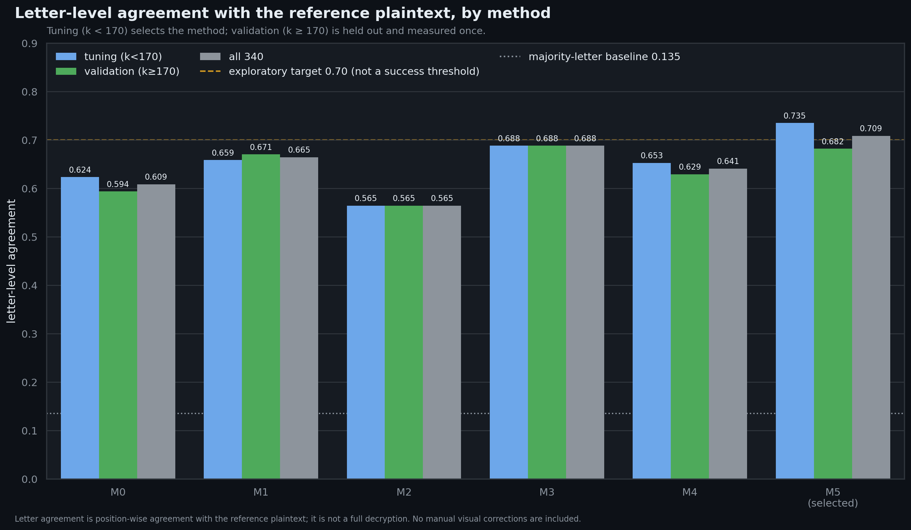
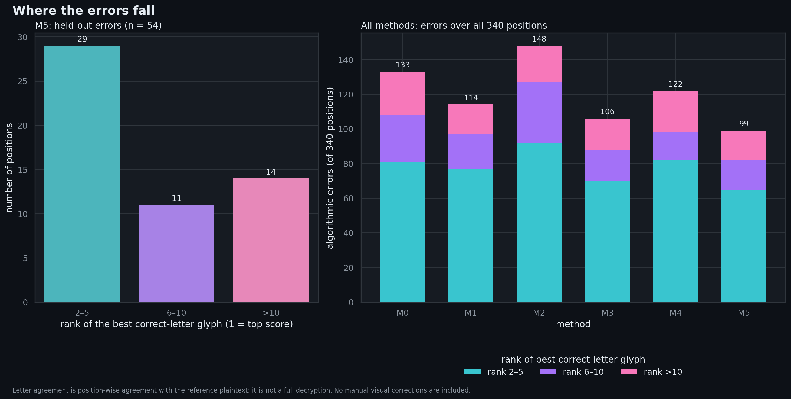
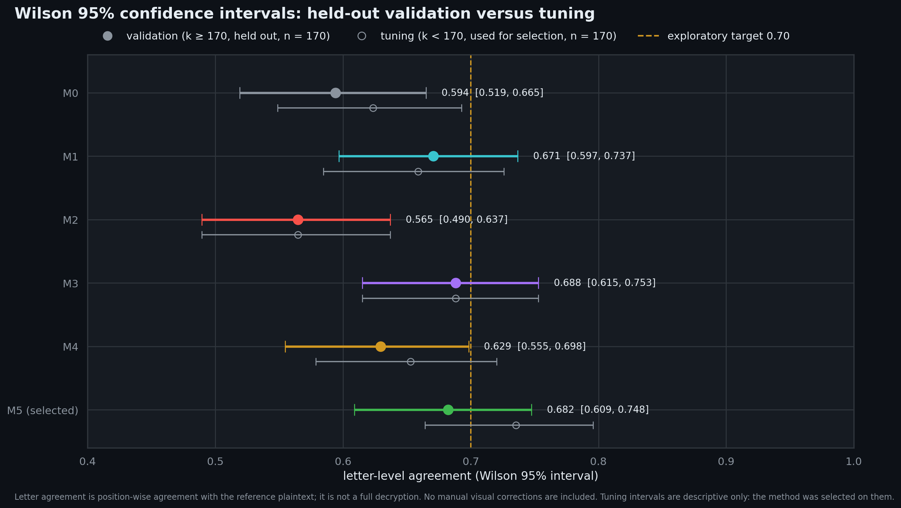

# The Zodiac Cipher Investigation (Z340 and Z32)

A documented research record of an attempt to read two Zodiac ciphers. It shows what was tried, what worked, what failed, and what is still unknown.

<p align="center">
  
</p>

> **Short answer:** no cipher is solved in this repository. The best held-out result is **68.2 % letter agreement** with the published Z340 plaintext, for a method whose selection rule was written before the comparison was run. That figure measures agreement with a published reading. It does not independently verify that reading.

## What is this about?

In 1969 and 1970 a killer who has never been publicly identified sent coded messages to newspapers in the San Francisco Bay Area. Two of them are studied here:

| Message | Sent | What it looks like | Status here |
|---|---|---|---|
| **Z340** | 8 November 1969 (San Francisco Chronicle) | 340 symbols in a 20 × 17 grid | Partly reproduced: our reading agrees with the published plaintext on 68.2 % of held-out letters. A full decryption was published in March 2024 (arXiv:2403.17350); we did not reproduce its final result. |
| **Z32** | Letter dated 26 June 1970 | 32 symbols in two rows (17 and 15) | Not decrypted. |

## The 60-second version

1. **Build the key.** A published figure lists 63 symbol shapes. Each shape stands for one of 21 letters, and most letters have several shapes.
2. **Read the grid.** The 340 symbols form a 20 × 17 grid. The first nine rows follow a fixed arithmetic reading pattern. The remaining eleven rows do not: 93 cells differ from that pattern. This is an open issue.
3. **Match symbols to shapes.** An algorithm compares each grid symbol with all 63 key shapes, picks the most similar one, and reads the letter that shape stands for.
4. **Measure against the published reading.** We compare the letters we read with the published plaintext, using only positions that did not take part in choosing the method.

## Three charts, three questions

### 1. Which method did best?

Look at the chart at the top. Blue bars are the *tuning* positions, which we used to choose the method. Green bars are *held-out* positions, which we did not use for choosing. The dashed amber line is our exploratory 70 % target. The dotted line is what you get by always guessing the most common letter, E: about 13.5 %.

The method we selected in advance, **M5**, reads **68.2 %** of held-out letters correctly against the published plaintext. The 70 % target was not reached.

### 2. Where do the mistakes come from?

<p align="center">
  
</p>

Most mistakes are close calls. For the selected method's 54 held-out errors, the correct letter's best shape was ranked 2nd to 5th in 29 of them. The right panel shows the error totals for all six methods; M5 has the fewest.

### 3. How sure are we?

<p align="center">
  
</p>

Each bar is a 95 % confidence interval: the range the true accuracy plausibly lies in, given how many positions were tested. For the selected method, held-out accuracy is 0.682 with an interval of 0.609 to 0.748. That interval includes 0.70, so **we cannot say whether a method reaches 70 %**. Hollow markers show tuning accuracy. It is higher than held-out accuracy because the method was chosen on those positions, so it is shown for context only.

## What we found, in plain words

- On the positions used for choosing, the selected method reads 73.5 % of letters correctly. On held-out positions it reads 68.2 %. The gap is why we report only the held-out figure.
- The honest baseline is low: always guessing E gets 46 of 340 letters (13.5 %).
- The baseline matcher (M0) reads 207 of 340 letters correctly (60.9 %) over all positions. Six visual corrections, each recorded with its evidence, raise that to 213 (62.6 %). The corrections are reported separately, because they are not algorithmic.

## What we did not achieve

- **A full Z340 decryption.** Not reproduced. We rebuilt the pipeline from the paper's figures and reproduced our own intermediate outputs, but not the final decryption.
- **The 70 % exploratory target.** Not reached on held-out positions (68.2 %).
- **Z32.** Not decrypted. A pre-registered test for shared keys (H4a) is designed and calibrated, but has not been run.
- **A candidate location** (37.929792, −122.150318) from earlier work. It is **not confirmed**, its source is not recorded in the project files, and it is not supported under the conventions we pre-registered.
- **The map's edition and scale.** Still unresolved: a 1968 or a 1969 Phillips 66 road map.

## How we tried to stay honest

- **Pre-registration for the comparison.** The six methods (M0 to M5), the split (positions 0 to 169 for choosing, 170 to 339 for measurement), and the selection rule were written in `z32_checkpoint/methods/PREREG_METHODS.md` before the comparison was run.
- **Earlier development is disclosed.** The matcher versions v1 to v4 were developed before that pre-registration and were not pre-registered. The record does not show whether those versions used positions 170 to 339.
- **Blind review.** Ten disputed symbols were reviewed as shapes only, without letter labels. The independence is partial, and `z32_checkpoint/FIRST10_MISMATCH_AUDIT.md` says so.
- **Separate tracks.** Algorithmic results and manual corrections are reported separately.
- **Automatic checks.** `tests/check_archive.py` verifies checksums, required files, documentation links, the absence of non-English text, and a set of reported numbers recomputed from the raw files.
- **Contradictions kept on record.** Open questions are listed, not hidden. See section 13 of `ZODIAC_CIPHER_RESEARCH_DOSSIER.md` and `docs/DISCREPANCY_AUDIT.md`.

## Where to look

| If you want to… | Go to |
|---|---|
| Read the full story and every caveat | `ZODIAC_CIPHER_RESEARCH_DOSSIER.md` |
| Rebuild the results step by step | `docs/REPRODUCTION_GUIDE.md` |
| Find the source publications | `docs/SOURCES.md` |
| See what was checked and what is still open | `docs/DISCREPANCY_AUDIT.md` |
| Read the Z340 reconstruction code and results | `z32_checkpoint/` |
| Read the independent re-derivation of the 2023 Z32 analysis | `z32_independent_audit/` |
| Read the Z32 structure, geometry, and H4a design | `z32_structure/`, `z32_phase5_audit/`, `z32_h4/` |
| Regenerate or inspect the charts | `assets/` |
| Check that the files are intact | `manifests/SHA256SUMS.txt` |

## Run it yourself

```bash
python3 -m pip install -r requirements.txt   # Python packages, versions pinned
python3 tests/check_archive.py               # integrity and reported-number checks
python3 assets/make_charts.py                # regenerate the three charts from the archived results
```

The full Z340 pipeline also needs the arXiv PDF, which is not redistributed here. The reproduction guide explains how to regenerate what is needed from your own copy.

## Words you will meet

| Word | Plain meaning |
|---|---|
| **Cipher** | A secret code that replaces or rearranges letters. |
| **Homophonic substitution** | One letter can be written with several different symbols. |
| **Transposition** | The symbols are all present, but read in a different order. |
| **Key shape (glyph)** | One of the 63 drawn symbols in the key. |
| **Tuning vs held-out** | Tuning positions were used to choose the method; held-out positions were not. |
| **Pre-registration** | Writing the rules down before looking at the results. |
| **Wilson interval** | A 95 % range for an accuracy, given how many positions were tested. |
| **Majority baseline** | The score from always guessing the most common letter. |

## About the images

The three charts in `assets/` are original visualizations, generated from our own result files by `assets/make_charts.py`. They contain no figure or photograph from any publication. Their inputs include a reference text transcribed from the published plaintext, so the accuracy numbers depend on that transcription. See `docs/IMAGE_PROVENANCE.md`.

## Licence, language, and sources

- **Software:** MIT License (`LICENSE`).
- **Documentation and original outputs:** Creative Commons Attribution 4.0 International (`LICENSING.md`).
- **Third-party material:** not included and not relicensed. Data derived from the publications remains subject to their terms. See `docs/SOURCES.md` and `docs/LICENSE_STATUS.md`.
- **Language:** all repository text is in English. Working notes that were originally written in Arabic were translated; see `docs/ARCHIVE_CHANGES.md`, section 10.
- **Integrity:** every file is listed with its SHA-256 in `manifests/SHA256SUMS.txt`. Check with `sha256sum -c manifests/SHA256SUMS.txt`.

## Questions and corrections

Open an issue. Corrections are welcome, especially on the open items in section 13 of the dossier.
